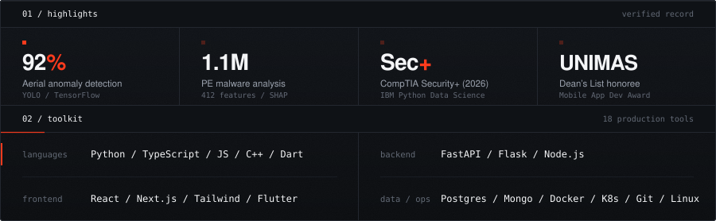

<picture>
  <source media="(prefers-color-scheme: dark)" srcset="assets/hero-dark.svg" />
  <source media="(prefers-color-scheme: light)" srcset="assets/hero-light.svg" />
  
</picture>

 

Building dependable digital products at the intersection of **software, AI, and human needs** — leading hospital digital platforms at **Hospital Miri** and co-founding **Scribear**.

[valeport.space](https://www.valeport.space) &nbsp;/&nbsp; [linkedin](https://www.linkedin.com/in/valentine-a-a278a7254) &nbsp;/&nbsp; [valentineagam6@gmail.com](mailto:valentineagam6@gmail.com)

 

<picture>
  <source media="(prefers-color-scheme: dark)" srcset="assets/specs-dark.svg" />
  <source media="(prefers-color-scheme: light)" srcset="assets/specs-light.svg" />
  
</picture>

### Selected work

| No. | Project | Overview | Stack |
| :--- | :--- | :--- | :--- |
| `01` | [**XAI-PE Analyzer**](https://github.com/nishika25-ta/XAI) | Explainable malware analysis across 412 PE features, SHAP insights, and batch workflows. | `Python` `XGBoost` `SHAP` `Flask` |
| `02` | [**Darklace AI**](https://github.com/nishika25-ta/Darklace-AI) | Real-time desktop meeting assistant with voice input and streamed AI responses. | `Python` `React` `Electron` `WebSockets` |
| `03` | [**Pelita Clinic**](https://pelitaclinic-latest.vercel.app) | Accessible multilingual clinic platform and service discovery experience. | `Next.js` `TypeScript` `Playwright` |
| `04` | [**Amazing Penan Store**](https://github.com/nishika25-ta/APSM) | Cultural-commerce storefront with persistent cart and Stripe checkout. | `Next.js` `Stripe` `Zustand` |
| `05` | [**Miri City Medical Centre**](https://miri-city-medical-center.vercel.app) | Patient-focused hospital hub for specialists, facilities, rates, and emergency access. | `Next.js` `TypeScript` `Framer Motion` |

### Experience

| Period | Role | Impact |
| :--- | :--- | :--- |
| `Jun 2026 — Present` | **Corporate Communications & Information Officer** — Hospital Miri | Leading end-to-end delivery of hospital web, onboarding, asset-tracking, and wayfinding platforms with Next.js, PostgreSQL, Docker, and Kubernetes. |
| `Mar 2026 — Present` | **Co-Founder & Full-Stack Developer** — Scribear | Designing and shipping web products, backend services, REST APIs, data models, and production deployments for regional businesses. |
| `Dec 2025 — Mar 2026` | **Junior Data & Backend Engineer** — Zenara Jaya | Built AI-assisted recruitment, OCR, fraud detection, reporting, RBAC, and audit workflows with Python, FastAPI, and PostgreSQL. |
| `Jul 2024 — Oct 2024` | **GIS Data Analyst Intern** — Sarawak Oil Palms Berhad | Developed a YOLO/TensorFlow aerial anomaly detector at **92% accuracy** and automated geospatial reporting with Python, OpenCV, and QGIS. |

---

Miri, Sarawak — engineering thoughtful systems where people, data, and reliable software meet. <a href="mailto:valentineagam6@gmail.com">Email</a> / <a href="https://www.linkedin.com/in/valentine-a-a278a7254">LinkedIn</a> / <a href="https://www.valeport.space">Portfolio</a>
